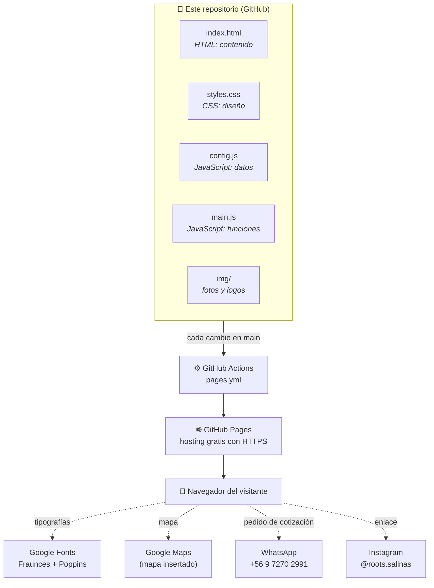
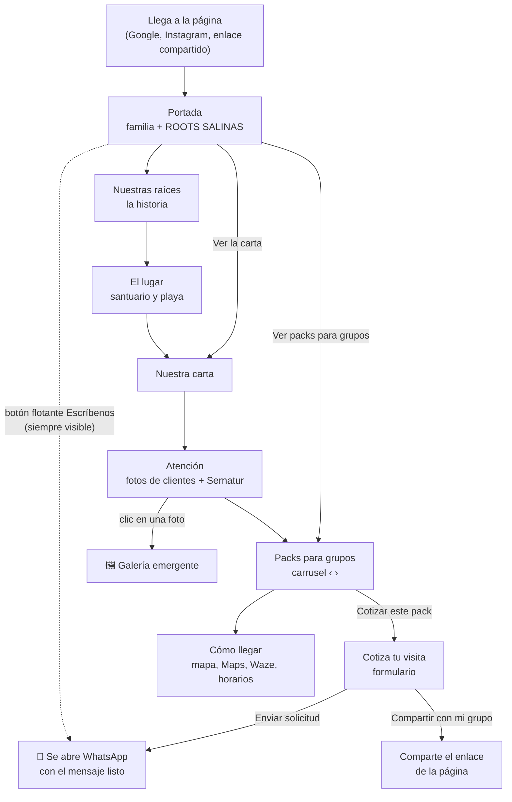
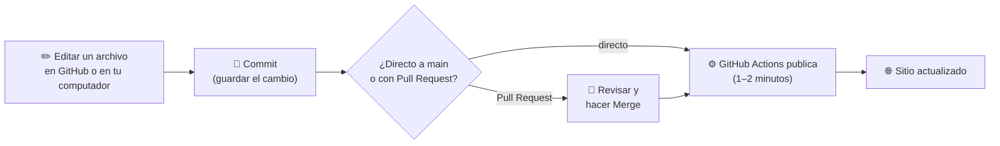

# Roots Salinas · sitio web

Landing page de **Roots Salinas**, local gastronómico familiar en Playa Las Salinas de Pullally,
comuna de Papudo. *Sabores con raíces, experiencias junto al mar.*

🌐 **Sitio publicado:** https://rootssalinas.cl
(la dirección antigua, https://openweb-cl.github.io/roots_web/, redirige sola al dominio).

> **En una frase:** es una sola página web hecha con **HTML, CSS y JavaScript puros** (sin
> frameworks ni instalaciones), guardada en este repositorio y publicada gratis con **GitHub Pages**.
> Cada cambio que entra a `main` se publica solo en 1 o 2 minutos.

**Índice:** [Mapa del repositorio](#1-mapa-del-repositorio) ·
[Mapa de tecnología](#2-mapa-de-tecnología) ·
[Mapa de uso](#3-mapa-de-uso) ·
[Cómo hacer cambios](#4-cómo-hacer-cambios-recetas-rápidas) ·
[Ver el sitio en tu computador](#5-ver-el-sitio-en-tu-computador)

---

## 1. Mapa del repositorio

```
roots_web/
│
├── index.html                ← LA PÁGINA. Todo el contenido y el orden de las secciones.
│
├── assets/
│   ├── css/
│   │   └── styles.css        ← EL DISEÑO. Colores, letras, tamaños, versión celular.
│   │
│   ├── js/
│   │   ├── config.js         ← LOS DATOS. WhatsApp, horarios, carta, packs, preguntas.
│   │   │                        (Es el archivo que más se edita.)
│   │   ├── i18n.js           ← LOS IDIOMAS. Lista de idiomas del menú y textos base en español.
│   │   ├── idiomas/          ← LAS TRADUCCIONES. Un archivo por idioma:
│   │   │                        en, pt, it, fr, de, zh (inglés, portugués, italiano,
│   │   │                        francés, alemán y chino).
│   │   └── main.js           ← EL FUNCIONAMIENTO. Arma la carta y los packs, el carrusel,
│   │                            la galería, el mapa, el menú, los idiomas y el envío a WhatsApp.
│   └── img/
│       ├── logo.jpg              logo redondo (menú y pie de página)
│       ├── favicon.png           ícono de la pestaña del navegador
│       ├── apple-touch-icon.png  ícono al guardar la web en el celular
│       ├── og-image.jpg          imagen que aparece al compartir el enlace
│       ├── carta-roots-salinas.jpg   carta impresa ("Ver la carta impresa")
│       ├── sello-sernatur.png    sello de Servicio Turístico Registrado
│       └── fotos/                todas las fotos de la página (ver tabla abajo)
│
├── .github/workflows/
│   └── pages.yml             ← EL PUBLICADOR. Sube el sitio a GitHub Pages en cada cambio.
│
├── robots.txt                permite que Google indexe el sitio
├── .nojekyll                 le dice a GitHub que publique los archivos tal cual
├── PLAN.md                   plan original del proyecto y decisiones de diseño
└── README.md                 este archivo
```

### Qué hay en la página, de arriba hacia abajo

Cada sección es un bloque `<section>` en `index.html`, marcado con un comentario
(`<!-- HERO -->`, `<!-- NOSOTROS -->`, etc.) para encontrarlo fácil.

| # | Sección en pantalla | Comentario en `index.html` | De dónde sale el contenido |
|---|---|---|---|
| 1 | Menú superior | `<header class="nav">` | `index.html` |
| 2 | Portada: foto de la familia, ROOTS SALINAS | `<!-- HERO -->` | `index.html` |
| 3 | Nuestras raíces (historia + 4 fotos) | `<!-- NOSOTROS -->` | `index.html` |
| 4 | El lugar (santuario, humedal, mar) | `<!-- EL LUGAR -->` | `index.html` |
| 5 | Nuestra carta | `<!-- CARTA -->` | fotos en `index.html`, productos en `config.js` → `carta` |
| 6 | Una atención que se recuerda + Sernatur | `<!-- ATENCIÓN -->` | `index.html`; galería emergente en `main.js` |
| 7 | Packs para grupos (carrusel) | `<!-- PACKS -->` | `config.js` → `packs` |
| 8 | Cotiza tu visita (formulario) | `<!-- RESERVA -->` | `index.html`; envío en `main.js` |
| 9 | Cómo llegar, horarios y preguntas | `<!-- UBICACIÓN -->` | `config.js` → `contacto`, `horarios`, `faq` |
| 10 | Síguenos en Instagram | `<!-- INSTAGRAM -->` | `config.js` → `contacto.instagram` |
| 11 | Pie de página y botón flotante "Escríbenos" | `<footer>` | `index.html` + `config.js` |

### Fotos (`assets/img/fotos/`)

| Archivo | Dónde aparece |
|---|---|
| `familia-roots.jpg` | Portada |
| `carro-churros.jpg`, `heladeria.jpg`, `carro-negro.jpg`, `equipo.jpg` | Nuestras raíces |
| `hero-playa.jpg`, `humedal.jpg`, `ola.jpg` | El lugar (`ola.jpg` también de fondo en Instagram) |
| `churrasco-salinero.jpg`, `empanadas.jpg`, `churros.jpg` | Nuestra carta |
| `clientes-1.jpg` … `clientes-6.jpg` | Atención y galería emergente |
| `grupo-adultos.jpg`, `grupo-surfistas.jpg` | Packs para grupos |
| `grupo-motoqueros.jpg` | Cotiza tu visita |
| `churrasco.jpg` | *Sin uso* (foto anterior del churrasco italiano; se puede borrar) |

> 💡 Para **cambiar una foto sin tocar código**, sube la nueva con **el mismo nombre de archivo**
> y reemplaza la anterior. Conviene que pese menos de 400 KB (JPG, unos 1.400 px de ancho).

---

## 2. Mapa de tecnología



| Pieza | Qué es | Para qué se usa aquí |
|---|---|---|
| **HTML** | El lenguaje que describe el contenido de una página web | Textos, secciones, fotos y formulario (`index.html`) |
| **CSS** | El lenguaje del diseño | Colores negro y dorado, tipografías, curvas de duna, versión celular (`styles.css`) |
| **JavaScript** (puro, sin librerías) | El lenguaje que da comportamiento | Arma la carta y los packs desde `config.js`, carrusel, galería emergente, menú del celular, mapa y mensaje de WhatsApp (`main.js`) |
| **GitHub** | Donde vive el código y su historial | Cada cambio queda guardado y se puede revisar o deshacer |
| **GitHub Actions** | Automatización de GitHub | Publica el sitio solo en cada cambio a `main` (`pages.yml`) |
| **GitHub Pages** | Hosting gratuito de GitHub | Sirve la página con HTTPS y rápido en todo Chile |
| **Google Fonts** | Tipografías gratuitas | *Fraunces* para títulos, *Poppins* para texto |
| **Google Maps** | Mapa insertado | Muestra el pin de Roots Salinas en "Cómo llegar" |
| **WhatsApp** | Mensajería | Recibe las cotizaciones de grupos (no hay servidor ni base de datos) |

**Lo que *no* usa (a propósito):** no hay React, WordPress, base de datos, servidor propio ni
paso de "compilación". Por eso carga rápido con la señal de la playa, no tiene costos de hosting
y cualquiera puede editarlo directo desde GitHub.

---

## 3. Mapa de uso

### Cómo recorre la página un visitante



**Cómo funciona la cotización:** el visitante llena el formulario (organizador, tipo de grupo,
pack, personas, fecha), toca **Enviar solicitud** y se abre WhatsApp con el mensaje ya escrito al
número del local. Solo tiene que tocar *enviar*. Si algún día el número de WhatsApp queda vacío en
`config.js`, el mensaje se copia y se abre el chat de Instagram.

### Cómo se actualiza la página (para quien la mantiene)



> ⏱️ Después de publicar, los navegadores pueden mostrar la versión anterior hasta **10 minutos**
> (caché). Para verlo al tiro: **Ctrl + F5** en el computador o una pestaña de incógnito en el celular.

---

## 4. Cómo hacer cambios (recetas rápidas)

La forma más simple es **editar directo en GitHub**: abre el archivo, toca el lápiz ✏️, cambia lo
que necesites y abajo pulsa **Commit changes**.

| Quiero cambiar… | Archivo | Qué buscar |
|---|---|---|
| Número de WhatsApp | `assets/js/config.js` | `whatsapp: "569…"` (solo dígitos, con 56) |
| Horarios | `assets/js/config.js` | `horarios: [ … ]` |
| Productos de la carta | `assets/js/config.js` | `carta: [ … ]` |
| Mostrar los precios de la carta | `assets/js/config.js` | `mostrarPrecios: false` → `true` |
| Packs (nombre, qué incluye, mínimo) | `assets/js/config.js` | `packs: [ … ]` |
| Mostrar el precio "desde $X" de los packs | `assets/js/config.js` | `mostrarValoresBase: false` → `true` |
| Preguntas frecuentes | `assets/js/config.js` | `faq: [ … ]` |
| Textos de la portada o de la historia | `index.html` | `<!-- HERO -->` o `<!-- NOSOTROS -->` |
| Datos del registro Sernatur | `index.html` | `class="sernatur"` |
| Una foto | `assets/img/fotos/` | subir la nueva **con el mismo nombre** |
| Fotos de la galería de clientes | `assets/js/main.js` | `fotosClientes` (los textos están en `i18n.js` → `cliente.1` … `cliente.6`) |
| Un texto en otro idioma | `assets/js/idiomas/<idioma>.js` (ej. `fr.js`) | la clave del texto (`data-i18n="…"` en `index.html`) o, para la carta y los packs, el texto en español |
| Colores o tipografías | `assets/css/styles.css` | `:root { --gold: …; --night: … }` al inicio |

🌐 **Idiomas:** la página está en 7 idiomas: español, inglés, portugués, italiano, francés, alemán y
chino (menú desplegable 🌐 arriba a la derecha). El español es el texto original de `index.html` y
`config.js`; cada traducción está en `assets/js/idiomas/` (un archivo por idioma). Si cambias un
texto en español, actualiza también sus traducciones: si falta alguna, ese texto aparece en español.
Se puede compartir un idioma con `?lang=en`, `?lang=fr`, `?lang=zh`, etc. al final del enlace.

**Agregar otro idioma:** copia `assets/js/idiomas/en.js` con el código nuevo (ej. `ja.js`), traduce
sus textos, agrégalo a la lista `idiomas` de `assets/js/i18n.js` y suma su `<script>` en `index.html`.

⚠️ **Cuidado al editar `config.js`:** respeta las comillas `"…"` y las comas `,` al final de cada
línea. Si falta una, la carta y los packs dejan de aparecer. Si pasa, revisa el último cambio o
deshazlo desde el historial de GitHub.

---

## 5. Ver el sitio en tu computador

No hay nada que instalar aparte de Python (o cualquier servidor simple). Desde la carpeta del
repositorio:

```bash
python -m http.server 8000
```

Luego abre http://localhost:8000 en el navegador. Para detenerlo, `Ctrl + C`.

---

**Créditos de fotos:** las de la familia, el equipo, el local, los clientes y el churrasco salinero
son de Roots Salinas. Las de *El lugar*, empanadas y churros son imágenes referenciales; «Ola en
Papudo» es de Trinicorrea1 (CC BY-SA 3.0) vía Wikimedia Commons.
